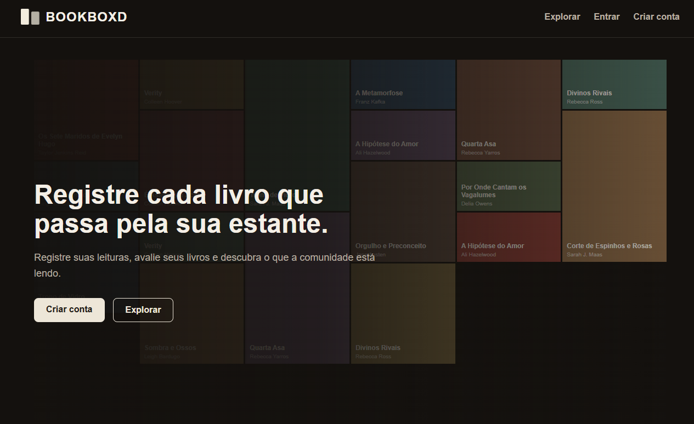
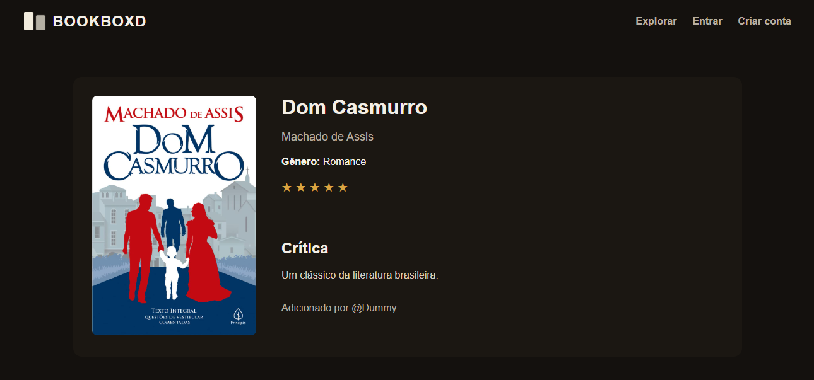
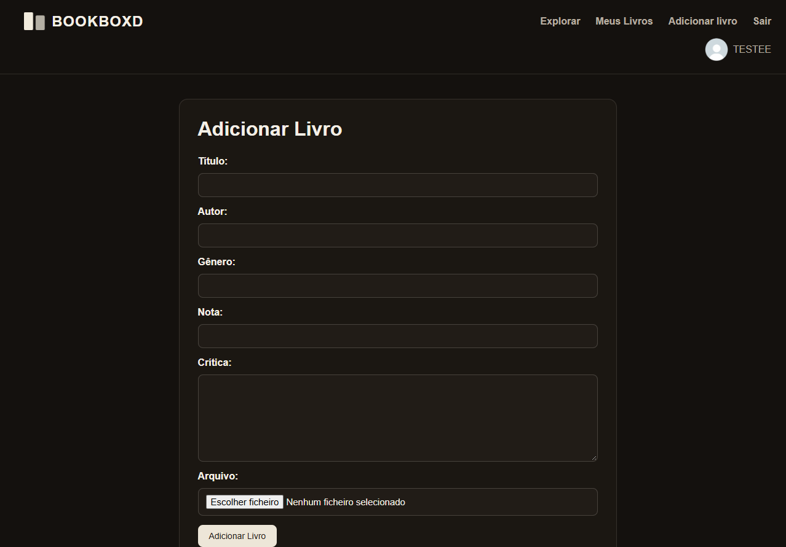

# 📚 Bookboxd

O Bookboxd é uma aplicação web desenvolvida em Laravel como projeto acadêmico da disciplina de Desenvolvimento Web.

A proposta do projeto é funcionar como um diário de leitura, onde cada usuário pode cadastrar livros, adicionar uma capa, atribuir uma nota e escrever uma crítica.

## ✨ Funcionalidades

- Cadastro de usuários
- Login e logout
- Cadastro de livros
- Edição de livros
- Exclusão de livros
- Upload de capa
- Avaliação de 1 a 5 estrelas
- Escrita de críticas
- Página Explorar
- Página Meus Livros
- Paginação
- Controle de acesso por usuário
- Apenas o autor do registro pode editar ou excluir o livro

## 🛠️ Tecnologias utilizadas

- PHP
- Laravel
- MySQL
- Blade
- HTML
- CSS

## 📸 Screenshots

### Página inicial



### Explorar livros


### Detalhes do livro



### Cadastro de livro



## 🗄️ Banco de dados

O projeto utiliza MySQL.

A tabela principal é a `tb_livros`, responsável por armazenar informações como:

- título
- autor
- gênero
- nota
- crítica
- arquivo da capa
- usuário responsável pelo cadastro

## 🚀 Como executar o projeto

### 1. Clone o repositório

```bash
git clone URL_DO_REPOSITORIO
```

### 2. Entre na pasta do projeto

```bash
cd bookboxd-laravel
```

### 3. Instale as dependências

```bash
composer install
```

### 4. Configure o ambiente

Crie uma cópia do arquivo `.env.example` com o nome `.env`.

Configure nele os dados do seu banco MySQL.

Exemplo:

```env
DB_CONNECTION=mysql
DB_HOST=127.0.0.1
DB_PORT=3306
DB_DATABASE=livros
DB_USERNAME=root
DB_PASSWORD=
```

### 5. Gere a chave da aplicação

```bash
php artisan key:generate
```

### 6. Crie as tabelas e os registros iniciais

```bash
php artisan migrate --seed
```

### 7. Inicie o servidor

```bash
php artisan serve
```

### 8. Acesse

`http://127.0.0.1:8000`

## 🎓 Sobre o projeto

Projeto acadêmico desenvolvido na disciplina de Desenvolvimento Web, com foco na aplicação prática de Laravel, CRUD, autenticação, banco de dados, migrations, seeders, upload de arquivos, validação, paginação e controle de acesso.